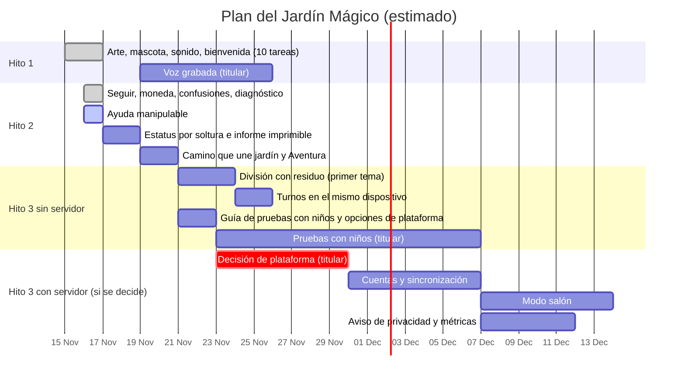
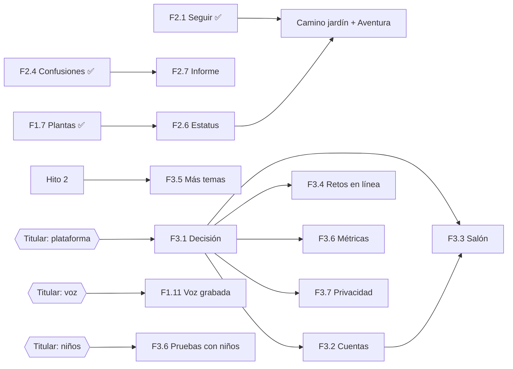

# Plan de proyecto

El Jardín Mágico de las Multiplicaciones: de un buen juego de tablas a uno de
calidad comparable a los líderes, y después a una plataforma de aprendizaje.

**Actualizado: 16 de noviembre de 2026.**
- El estado del día a día está en el
  [issue de estado #20](https://github.com/dleon55/jardin-magico-multiplicaciones/issues/20).
- El detalle de cada cambio, con su PR, está en el [CHANGELOG](../CHANGELOG.md).

## Resumen

| Hito | Issue | Avance | Estado |
|------|-------|--------|--------|
| 1 · Calidad que se ve y se oye | [#45](https://github.com/dleon55/jardin-magico-multiplicaciones/issues/45) | **10 de 11** | Casi cerrado: falta la voz grabada, que depende del titular |
| 2 · Un solo camino y mejor enseñanza | [#46](https://github.com/dleon55/jardin-magico-multiplicaciones/issues/46) | **4 de 7** (+1 parcial) | En curso |
| 3 · Plataforma | [#47](https://github.com/dleon55/jardin-magico-multiplicaciones/issues/47) | **0 de 7** | Esperando la decisión del titular (#66); lo que no necesita servidor puede empezar |

**Cifras al día:**
- 14 PRs fusionados desde que empezó el plan (#73 a #86), cada uno verificado en el sitio publicado.
- La compuerta de calidad (`npm run comprobar`) tiene **911 pruebas en verde**, en escritorio y tableta.
- Cada cambio pasó una **comprobación de mutaciones**: romper el código a propósito y ver que una prueba falla.
- `index.html` pesa 507 KB, sin dependencias externas, y funciona sin internet.

## Objetivos cumplidos

### Hito 1 · Calidad que se ve y se oye

| Tarea | Issue | PR | Qué quedó |
|-------|-------|----|-----------|
| F1.1 Guía de estilo | #48 | #73 | [`ESTILO.md`](ESTILO.md): colores como variables, reglas medibles del dibujo, movimiento, iconos |
| F1.2 Mascota | #52 | #74 | **Lumi**, con 6 caras, en la bienvenida, la partida y la victoria |
| F1.8 Celebraciones | #49 | #75 | Racha con globo de Lumi, florecer con brillo y bono, victoria con ritmo, confeti propio |
| F1.10 Bienvenida guiada | #58 | #76 | 5 pasos con Lumi hasta la primera tabla (6 toques); se puede saltar |
| F1.3 Héroes | #53 | #77 | 8 héroes SVG con tres poses (quieto, lanzando, golpeado) |
| F1.4 Enemigos y jefes | #54 | #77 | 6 enemigos y sus jefes con corona; «pof» al vencer |
| F1.5 Paisajes | #55 | #78 | 8 fondos de mundo y 6 arenas por capas (unos 15 KB) |
| F1.6 Iconos | #56 | #79 | 28 iconos propios en lugar de emojis de interfaz |
| F1.7 Plantas | #57 | #80, #82 | Forma por estado, florecido por mundo con un color por tabla, animación de lo que cambió |
| F1.9 Sonidos por capas | #50 | #81 | Un efecto por momento, en la escala de la música, con volumen igualado |
| F1.11 Voz grabada | #51 | — | **Pendiente del titular** |

### Hito 2 · Un solo camino y mejor enseñanza

| Tarea | Issue | PR | Qué quedó |
|-------|-------|----|-----------|
| F2.1 Seguir | #59 | #83 | Un botón propone lo que toca: regar, terminar la tabla, descubrir otra, repasar o un reto |
| F2.2 Una moneda y una meta | #60 | #84 | La estrella, solo para la moneda; meta de hoy: acertar 10 |
| F2.4 Confusiones típicas | #62 | #85 | Reconoce cuatro patrones de error, los nombra y practica juntos los que se cruzan |
| F2.3 Diagnóstico inicial | #61 | #86 | «¿Qué tablas ya sabes?»: siembra como «casi» lo que ya sabe y «Seguir» empieza por lo que falta |

**Calidad que se mantuvo en todo el camino:**
- accesibilidad WCAG 2.1 AA medida con axe en cada pantalla nueva;
- botones de 44 px;
- nada fuera de la pantalla en un teléfono vertical (360 × 640) ni acostado (740 × 360);
- «Menos movimiento» apaga toda animación nueva;
- sin internet.

## Pendientes

### De Claude (orden de trabajo)

| # | Tarea | Issue | Depende de | Notas |
|---|-------|-------|------------|-------|
| 1 | F2.5 Ayuda manipulable | [#63](https://github.com/dleon55/jardin-magico-multiplicaciones/issues/63) | — | **En curso** (PR #88): filas, partir con un toque, girar, flechas y total en voz |
| 2 | F2.6 Estatus por soltura | [#64](https://github.com/dleon55/jardin-magico-multiplicaciones/issues/64) | F1.7 ✅ | Debe respetar «Sin prisa» |
| 3 | F2.7 Informe imprimible | [#65](https://github.com/dleon55/jardin-magico-multiplicaciones/issues/65) | F2.4 ✅ | Usa las confusiones y la meta |
| 4 | Camino que une jardín y Aventura | #46 (criterio pendiente) | F2.1 ✅, F2.6 | Parcial: «Seguir» ya propone la Aventura al final; falta el mapa de tramos que se abren con lo aprendido |
| 5 | F3.5 Primer tema nuevo: división con residuo | [#71](https://github.com/dleon55/jardin-magico-multiplicaciones/issues/71) | Hito 2 | No necesita servidor |
| 6 | F3.4 Turnos en el mismo dispositivo | [#70](https://github.com/dleon55/jardin-magico-multiplicaciones/issues/70) | — | La parte sin servidor |
| 7 | F3.6 Guía de observación para pruebas con niños | [#72](https://github.com/dleon55/jardin-magico-multiplicaciones/issues/72) | — | El documento; las pruebas las hace el titular |
| 8 | F3.1 Documento con opciones de plataforma | [#66](https://github.com/dleon55/jardin-magico-multiplicaciones/issues/66) | — | Claude prepara opciones, costos y riesgos; **decide el titular** |
| 9 | F1.11 Guion de voz | [#51](https://github.com/dleon55/jardin-magico-multiplicaciones/issues/51) | Sí del titular | 40 a 60 frases con nombre de archivo |

### Del titular (no los puede hacer Claude)
- [ ] **Decidir la plataforma** (#66): servidor sí o no, costo, quién lo mantiene y datos de menores. Bloquea F3.2, F3.3, F3.4 en línea, las métricas de F3.6 y F3.7.
- [ ] **Voz grabada** (#51): quién graba y con qué permiso de uso.
- [ ] **Probar con niños** (#72): 3 a 5 niños de 8 a 11 años, en teléfono y tableta.
- [ ] **Probar en un teléfono modesto** la Aventura con 3 enemigos.
- [ ] **Probar en iPad y con lector de pantalla real** (VoiceOver o TalkBack).
- [ ] **Escuchar las muestras de sonido** (#50).
- [ ] **Revisar legalmente el aviso de privacidad** (#67), cuando se redacte.
- [ ] **Borrar las ramas fusionadas** (unas 55) y activar «Automatically delete head branches»: Claude no tiene permiso para borrar ramas.

## Cronograma

Son estimaciones. El ritmo del Hito 1 y lo que va del 2 fue de 3 a 4 tareas
por día de trabajo, cada una con su PR verificado. Lo que depende del titular
no tiene fecha propia: se indica qué queda bloqueado mientras tanto.

| Semana | Claude | Titular |
|--------|--------|---------|
| 16 al 22 de noviembre | Cerrar el Hito 2: ayuda manipulable, estatus, informe y camino | Probar en el teléfono lo nuevo |
| 23 al 29 de noviembre | División con residuo, turnos en un dispositivo, guía de pruebas, documento de plataforma | Decidir la voz; empezar pruebas con niños |
| 30 de noviembre al 13 de diciembre | Ajustes por lo que salga de las pruebas con niños; más temas (decimales y dinero) | **Decidir la plataforma** |
| Desde el 14 de diciembre | Si hay servidor: cuentas, salón, privacidad y métricas. Si no: más temas de la SEP | Revisión legal del aviso de privacidad |

## Dependencias

## Riesgos y mitigaciones

| Riesgo | Prob. | Impacto | Mitigación | Estado |
|--------|-------|---------|------------|--------|
| La Fase 3 se queda sin decisión de plataforma | Alta | Alto | F3.1 prepara opciones concretas con costo; mientras, avanza lo que no necesita servidor (más temas, turnos locales) | Abierto |
| No se prueba con niños reales y se decide a ciegas | Media | Alto | Guía de observación corta (F3.6); cada hallazgo se vuelve un issue | Abierto |
| La página se vuelve pesada o lenta en teléfonos modestos | Media | Medio | Arte generado con piezas reutilizables (15 KB de paisajes, 28 iconos en un solo juego de símbolos); animaciones solo con `transform`; prueba de peso | Mitigado; falta medir en un teléfono real |
| Romper el progreso guardado de los niños | Baja | Alto | Migraciones probadas en cada cambio de datos (misiones → meta, héroe guardado, «vistos») | Mitigado |
| Pruebas que no prueban nada (pasan aunque el código esté roto) | Media | Alto | Comprobación de mutaciones en cada PR. Ya destapó aserciones negativas que esperaban algo que desaparece solo; se corrigieron | Mitigado |
| Pruebas que dependen de la fecha real | Media | Medio | Fechas relativas a hoy en las pruebas nuevas; el cambio de día del 16 de noviembre destapó dos y se corrigieron | Mitigado |
| Un solo archivo de más de 500 KB es difícil de mantener | Media | Medio | Secciones con comentarios; si pasa de unos 700 KB, separar el arte y los datos en archivos (el service worker ya los guardaría sin internet) | Vigilado |
| Sin presupuesto de GitHub Actions: la compuerta depende de correrla en local | Alta | Medio | `npm run comprobar` antes de cada fusión, sin excepción; el resultado se escribe en cada PR | Mitigado |
| Arte desigual o que se parezca a otro juego | Baja | Medio | Guía de estilo con reglas medibles; todo dibujado desde cero | Mitigado |
| Datos de menores (LFPDPPP) si se añade servidor | Media | Alto | Hoy no sale nada del dispositivo. Con servidor: datos mínimos, alias, consentimiento y derechos ARCO (F3.7), revisión legal del titular | Abierto |
| Ramas fusionadas acumuladas (unas 55) | Alta | Bajo | Script de limpieza listo; el titular las borra o activa el borrado automático | Abierto |

## Cómo se trabaja cada tarea

Igual desde el principio:
- una rama y un PR por tarea, con un issue de seguimiento;
- pruebas automáticas y comprobación de mutaciones;
- la compuerta local `npm run comprobar` en verde antes de fusionar;
- README y CHANGELOG al día;
- verificar el sitio en vivo por el sello de `sw.js`;
- cerrar el issue con sus criterios marcados y actualizar #20.

**Reglas que no cambian:**
- sin internet;
- accesible (WCAG 2.1 AA);
- táctil (44 px, nada fuera de la pantalla);
- «Menos movimiento» lo apaga todo;
- arte y personajes originales;
- nada de publicidad ni de datos de los niños fuera del dispositivo sin decisión del titular.
