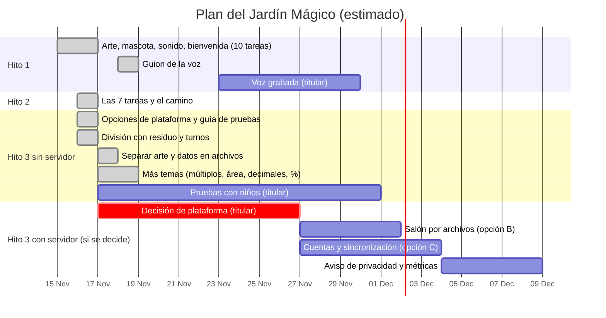
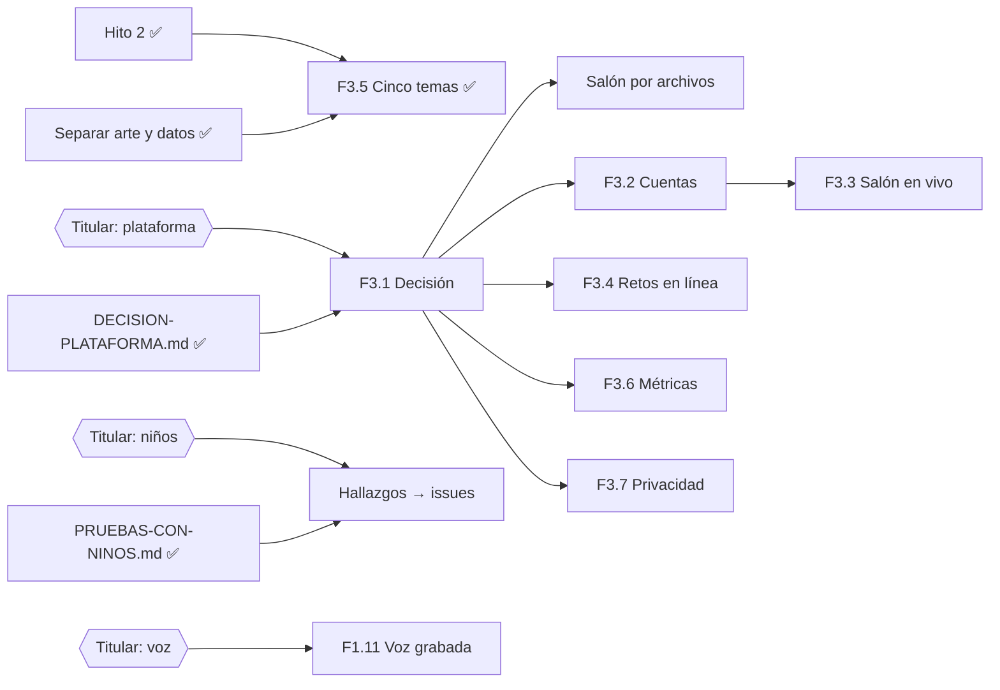

# Plan de proyecto

El Jardín Mágico de las Multiplicaciones: de un buen juego de tablas a uno de
calidad comparable a los líderes, y después a una plataforma de aprendizaje.

**Actualizado: 18 de noviembre de 2026.**
- El estado del día a día está en el
  [issue de estado #20](https://github.com/dleon55/jardin-magico-multiplicaciones/issues/20).
- El detalle de cada cambio, con su PR, está en el [CHANGELOG](../CHANGELOG.md).

## Resumen

| Hito | Issue | Avance | Estado |
|------|-------|--------|--------|
| 1 · Calidad que se ve y se oye | [#45](https://github.com/dleon55/jardin-magico-multiplicaciones/issues/45) | **10 de 11** | Casi cerrado: el guion de la voz está listo ([`GUION-VOZ.md`](GUION-VOZ.md)); faltan la grabación y el permiso, del titular |
| 2 · Un solo camino y mejor enseñanza | [#46](https://github.com/dleon55/jardin-magico-multiplicaciones/issues/46) | **7 de 7** | **Cerrado** el 16 de noviembre |
| 3 · Plataforma | [#47](https://github.com/dleon55/jardin-magico-multiplicaciones/issues/47) | **Todo lo que no necesita servidor, hecho** | Los cinco temas nuevos (#71 cerrado), turnos en un aparato, guía de pruebas y opciones de plataforma. Lo demás espera las decisiones del titular (#66, #72) |

**Cifras al día:**
- 29 PRs fusionados desde que empezó el plan (#73 a #101), cada uno verificado en el sitio publicado.
- La compuerta de calidad (`npm run comprobar`) tiene **más de 1170 pruebas en verde**, en escritorio y tableta.
- Cada cambio pasó una **comprobación de mutaciones**: romper el código a propósito y ver que una prueba falla.
- El juego, en varios archivos desde #96: `index.html` pesa 453 KB, más el arte, el sonido, los datos, los estilos propios y un archivo por tema en `js/`. Sin dependencias externas, y funciona sin internet.

## Objetivos cumplidos

### Hito 1 · Calidad que se ve y se oye

| Tarea | Issue | PR | Qué quedó |
|-------|-------|----|-----------|
| F1.1 Guía de estilo | #48 | #73 | [`ESTILO.md`](ESTILO.md): colores como variables, reglas medibles del dibujo, movimiento, iconos |
| F1.2 Mascota | #52 | #74 | **Lumi**, con 6 caras, en la bienvenida, la partida y la victoria |
| F1.8 Celebraciones | #49 | #75 | Racha con globo de Lumi, florecer con brillo y bono, victoria con ritmo, confeti propio |
| F1.10 Bienvenida guiada | #58 | #76 | 5 pasos con Lumi hasta la primera tabla (6 toques); se puede saltar |
| F1.3 Héroes | #53 | #77 | 8 héroes SVG con tres poses (quieto, lanzando, golpeado) |
| F1.4 Enemigos y jefes | #54 | #77 | 6 enemigos y sus jefes con corona; «pof» al vencer |
| F1.5 Paisajes | #55 | #78 | 8 fondos de mundo y 6 arenas por capas (unos 15 KB) |
| F1.6 Iconos | #56 | #79 | 28 iconos propios en lugar de emojis de interfaz |
| F1.7 Plantas | #57 | #80, #82 | Forma por estado, florecido por mundo con un color por tabla, animación de lo que cambió |
| F1.9 Sonidos por capas | #50 | #81 | Un efecto por momento, en la escala de la música, con volumen igualado |
| F1.11 Voz grabada | #51 | — | **Pendiente del titular** |

### Hito 2 · Un solo camino y mejor enseñanza (cerrado)

| Tarea | Issue | PR | Qué quedó |
|-------|-------|----|-----------|
| F2.1 Seguir | #59 | #83 | Un botón propone lo que toca: regar, el mundo recién abierto, terminar la tabla, descubrir otra, repasar o un reto |
| F2.2 Una moneda y una meta | #60 | #84 | La estrella, solo para la moneda; meta de hoy: acertar 10 |
| F2.4 Confusiones típicas | #62 | #85, #91 | Reconoce cuatro patrones de error, los nombra y practica juntos los que se cruzan |
| F2.3 Diagnóstico inicial | #61 | #86 | «¿Qué tablas ya sabes?»: siembra como «casi» lo que ya sabe y «Seguir» empieza por lo que falta |
| F2.5 Ayuda manipulable | #63 | #88 | Poner y quitar filas, partir con un toque (7 × 8 = 5 × 8 + 2 × 8), girar; flechas y total en voz, sin dar la respuesta |
| F2.6 Estatus por soltura | #64 | #89 | Semilla, arbolito, árbol y árbol con frutos por tabla, en el mapa y el jardín; respeta «Sin prisa»; se celebra al subir |
| F2.7 Informe imprimible | #65 | #91 | Una hoja carta para adultos, con una idea concreta para casa; se imprime o guarda como PDF, sin servidor |
| Camino jardín + Aventura | #46 | #92 | «Mi camino»: 15 tramos; cada mundo se abre al saberse sus tablas; nadie pierde lo jugado |

### Hito 3 · Plataforma (lo que no necesita servidor)

| Tarea | Issue | PR | Qué quedó |
|-------|-------|----|-----------|
| F3.1 Opciones de plataforma | #66 | #90 | [`DECISION-PLATAFORMA.md`](DECISION-PLATAFORMA.md): cuatro opciones con costo, riesgo y recomendación. **Falta la decisión del titular** |
| F3.6 Guía de pruebas con niños | #72 | #90 | [`PRUEBAS-CON-NINOS.md`](PRUEBAS-CON-NINOS.md): permiso, ocho tareas, hoja de registro, de la observación al issue. **Las sesiones son del titular** |
| F3.5 Primer tema nuevo: división con residuo | #71 | #93 | «17 ÷ 5 = 3, y sobran 2», con errores típicos explicados, ayuda visual y registro para adultos |
| F3.4 Turnos en el mismo aparato | #70 | #94 | «En equipo»: dos o tres niños se turnan; cada respuesta crece en el jardín de quien contesta; meta común, sin comparar |
| Separar el juego en archivos | — | #96 | Arte, sonido, datos y estilos fuera de `index.html` (569 → 445 KB); una prueba vigila la lista sin internet y el orden de carga |
| F3.5 Múltiplos y divisores | #71 | #97 | Múltiplo, divisor y «en dos tablas a la vez»; la ayuda muestra las tablas como filas |
| F3.5 Perímetro y área | #71 | #98 | Área, perímetro y un lado desde el área; la ayuda es el rectángulo de las tablas en cuadritos |
| F3.5 Decimales y dinero | #71 | #99 | Sumar precios llevando el peso, el cambio, varias cosas iguales y comparar decimales |
| F3.5 Porcentajes | #71 | #100 | El tanto por ciento, descuentos y fracción ↔ porcentaje, con 100 cuadritos |
| F1.11 Guion de la voz | #51 | #101 | [`GUION-VOZ.md`](GUION-VOZ.md): 50 frases con nombre de archivo, cómo grabar y modelo de permiso |

**Calidad que se mantuvo en todo el camino:**
- accesibilidad WCAG 2.1 AA medida con axe en cada pantalla nueva;
- botones de 44 px;
- nada fuera de la pantalla en un teléfono vertical (360 × 640) ni acostado (740 × 360);
- «Menos movimiento» apaga toda animación nueva;
- sin internet.

## Pendientes

### De Claude (orden de trabajo)

| # | Tarea | Issue | Depende de | Notas |
|---|-------|-------|------------|-------|
| 1 | Reproducir la voz grabada, con la sintética de respaldo | [#51](https://github.com/dleon55/jardin-magico-multiplicaciones/issues/51) | **Las grabaciones y el permiso del titular** | El guion dice qué archivo suena en cada momento |
| 2 | Salón por archivos (opción B de la plataforma) | #66 | **Decisión del titular** | Solo si elige A + B: la docente junta los archivos de su salón en su aparato |
| 3 | Convertir en issues los hallazgos de las pruebas con niños | #72 | **Las sesiones del titular** | Con la plantilla de la guía |
| 4 | Lo que se decida con servidor: cuentas, salón en vivo, privacidad, métricas | #66, #67 | **Decisión del titular** | Solo con la opción C o D |

**No queda trabajo de Claude que no dependa de una decisión o una tarea del
titular.** Si se quieren más temas que los cinco de #71 (por ejemplo,
fracciones decimales o medidas de tiempo), se abre un issue nuevo y se hacen
con el mismo método.

### Del titular (no los puede hacer Claude)
- [ ] **Decidir la plataforma** (#66): A, B, C o D, con el documento delante. Bloquea cuentas, salón en vivo, retos en línea, métricas y privacidad.
- [ ] **Probar con niños** (#72): 3 a 5 niños de 8 a 11 años, con la guía.
- [ ] **Voz grabada** (#51): quién graba y con qué permiso de uso.
- [ ] **Probar en un teléfono modesto** la Aventura con 3 enemigos.
- [ ] **Probar en iPad y con lector de pantalla real** (VoiceOver o TalkBack).
- [ ] **Escuchar las muestras de sonido** (#50).
- [ ] **Revisar legalmente el aviso de privacidad** (#67), cuando se redacte.
- [ ] **Borrar las ramas fusionadas** (más de 60) y activar «Automatically delete head branches»: Claude no tiene permiso para borrar ramas.

## Cronograma

Son estimaciones. El ritmo hasta ahora fue de 3 a 4 tareas por día de
trabajo, cada una con su PR verificado. Lo que depende del titular no tiene
fecha propia: se indica qué queda bloqueado mientras tanto.

| Semana | Claude | Titular |
|--------|--------|---------|
| 16 al 22 de noviembre | **Hecho:** separar en archivos, los cuatro temas que faltaban y el guion de la voz | Probar lo nuevo en el teléfono; leer el documento de plataforma |
| 23 al 29 de noviembre | Lo que pidan las decisiones o las pruebas del titular | **Decidir la plataforma**; grabar la voz; empezar pruebas con niños |
| 30 de noviembre al 13 de diciembre | Lo que salga de las pruebas con niños; salón por archivos si se elige B | Terminar las pruebas con niños |
| Desde el 14 de diciembre | Si se elige C: cuentas, salón en vivo, privacidad y métricas | Revisión legal del aviso de privacidad |

## Dependencias

## Riesgos y mitigaciones

| Riesgo | Prob. | Impacto | Mitigación | Estado |
|--------|-------|---------|------------|--------|
| La Fase 3 se queda sin decisión de plataforma | Alta | Alto | Documento de opciones con costo y recomendación (#90); mientras, avanza lo que no necesita servidor (ya: división con residuo y turnos) | Abierto: espera al titular |
| No se prueba con niños reales y se decide a ciegas | Media | Alto | Guía de observación lista (#90); cada hallazgo se vuelve un issue | Abierto: espera al titular |
| La página se vuelve pesada o lenta en teléfonos modestos | Media | Medio | Arte generado con piezas reutilizables (15 KB de paisajes, 28 iconos en un solo juego de símbolos); animaciones solo con `transform`; prueba de peso | Mitigado; falta medir en un teléfono real |
| Romper el progreso guardado de los niños | Baja | Alto | Migraciones probadas en cada cambio de datos (misiones → meta, héroe guardado, «vistos») | Mitigado |
| Pruebas que no prueban nada (pasan aunque el código esté roto) | Media | Alto | Comprobación de mutaciones en cada PR. Ya destapó aserciones negativas que esperaban algo que desaparece solo; se corrigieron | Mitigado |
| Pruebas que dependen de la fecha real o del azar | Media | Medio | Fechas relativas a hoy; datos fijos donde importa. Una prueba fallaba solo cuando salía 3 × 1 y se corrigió (#91) | Mitigado |
| Un solo archivo grande es difícil de mantener y pesa en teléfonos modestos | Media | Medio | Separado en #96: arte, sonido, datos y estilos en archivos aparte (index.html, 445 KB). Pruebas que vigilan el tamaño de cada archivo, la lista para usar sin internet y el orden de carga | Mitigado |
| Sin presupuesto de GitHub Actions: la compuerta depende de correrla en local | Alta | Medio | `npm run comprobar` antes de cada fusión, sin excepción; el resultado se escribe en cada PR | Mitigado |
| Arte desigual o que se parezca a otro juego | Baja | Medio | Guía de estilo con reglas medibles; todo dibujado desde cero | Mitigado |
| Datos de menores (LFPDPPP) si se añade servidor | Media | Alto | Hoy no sale nada del dispositivo. Con servidor: datos mínimos, alias, consentimiento y derechos ARCO (F3.7), revisión legal del titular | Abierto |
| Ramas fusionadas acumuladas (más de 60) | Alta | Bajo | Script de limpieza listo; el titular las borra o activa el borrado automático | Abierto |
| Un mundo cerrado de la Aventura frustra a quien quería jugar | Media | Medio | El primer mundo está abierto desde el primer día; lo ya jugado nunca se cierra; el cierre dice qué tabla falta | Mitigado; confirmar en pruebas con niños |
| El informe imprimible crece con cada tema y pasa de una hoja | Media | Bajo | Una línea por tema (#100); la prueba de «una hoja carta» siembra todas las clases de todos los temas, así que avisa si un tema nuevo la desborda | Mitigado |

## Cómo se trabaja cada tarea

Igual desde el principio:
- una rama y un PR por tarea, con un issue de seguimiento;
- pruebas automáticas y comprobación de mutaciones;
- la compuerta local `npm run comprobar` en verde antes de fusionar;
- README y CHANGELOG al día;
- verificar el sitio en vivo por el sello de `sw.js`;
- cerrar el issue con sus criterios marcados y actualizar #20.

**Reglas que no cambian:**
- sin internet;
- accesible (WCAG 2.1 AA);
- táctil (44 px, nada fuera de la pantalla);
- «Menos movimiento» lo apaga todo;
- arte y personajes originales;
- nada de publicidad ni de datos de los niños fuera del dispositivo sin decisión del titular.
